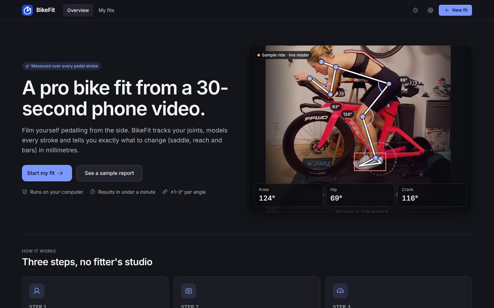
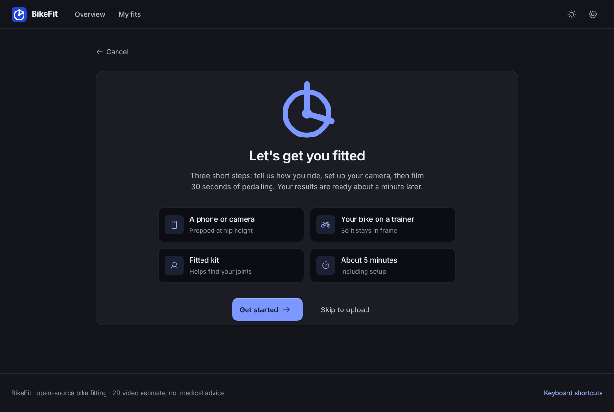
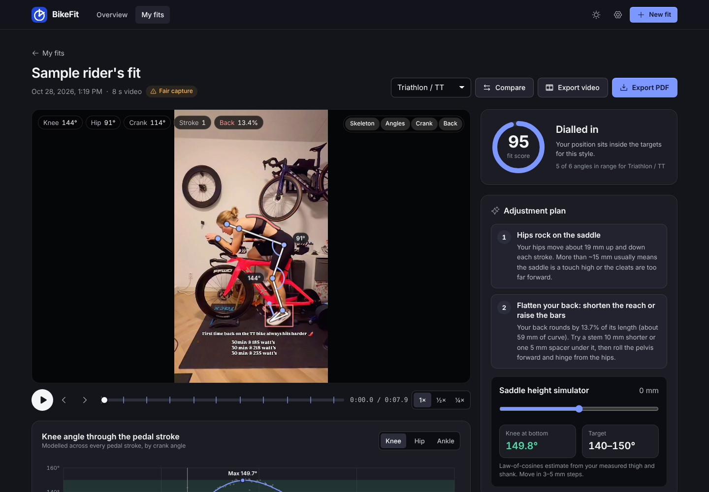
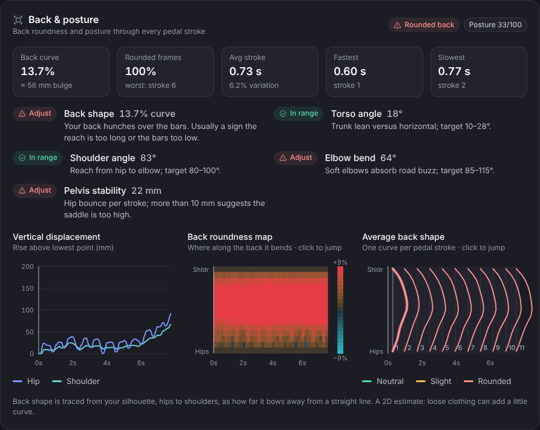
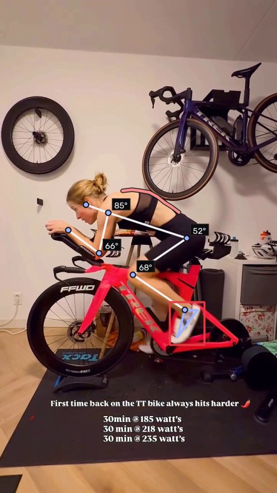
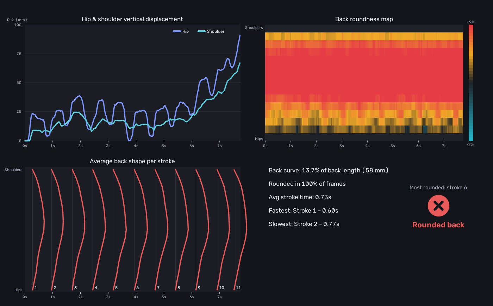
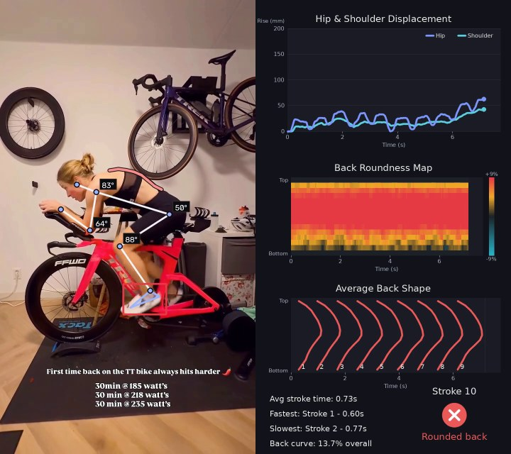

<p align="center"></p>

# BikeFit: open-source bike fitting


[](https://github.com/ultralytics/ultralytics)

**BikeFit** is a studio-grade bike fit from a short phone video: no fitter, no appointment, no subscription. It tracks your joints, models every pedal stroke and reads the shape of your back, then turns it into measured angles with confidence ranges and a ranked plan of what to change: saddle, reach and bars. Everything runs privately on your own computer, with no account and no cloud service.



## Why BikeFit exists

A professional bike fit at a local shop can cost hundreds, and app-based fitting services like MyVeloFit add up too. That puts a good position out of reach for a lot of riders, even though the core of a fit is measuring a handful of joint angles while you pedal.

BikeFit does that with plain computer vision on your own computer, for free. Use it as a baseline at home: measure your position, make one small change (saddle height, setback, stem), film again, and check the numbers moved the right way. You can make fast changes yourself and still be confident your fit is in a good range, and save a paid fitter for injuries or a new bike.

BikeFit is an independent open-source project and is not affiliated with MyVeloFit or any bike-fitting company.

| Guided onboarding | Fit report |
| :---: | :---: |
|  |  |

## What you get

- **New in 3.0: back roundness and posture correctness.** BikeFit traces your back from hips to shoulders in every frame and tells you whether you ride with a neutral or rounded back, stroke by stroke. A posture checklist combines back shape with torso, shoulder, elbow and pelvis stability, so you can ride longer and more comfortably. See [Back & posture](#back--posture).

- **Front and rear view (beta).** Film from in front of or behind the bike to check knee tracking, pelvic rock and left/right difference. These are hints only, with no score, and haven't been tried on real front or rear footage yet. See [Front and rear view](#front-and-rear-view-beta).
- **Frame-size check and KOPS.** The 3 o'clock frame shows where your knee sits over the pedal axle, and the plan says when the bike may be too long or too short, but only when two readings agree.
- **Traffic-light key frames.** Joint angles on the bottom and top of stroke frames are coloured green, amber or red.

- **Simple rider form.** Type your name and height, tap your riding style, flexibility, discomfort and crank length, then choose a camera setup: either an upload or an in-browser recording with a **live framing check** that confirms you're side-on, in frame and pedalling. It all runs offline, with no AI service.
- **Measured angles with confidence.** Knee extension and bend, hip, torso, shoulder and elbow, each reported with a 95% range.
- **A ranked adjustment plan.** Saddle height is given in millimetres when your height is known. A **saddle-height simulator** lets you preview the effect of each change.
- **Interactive report.** Your video plays with the skeleton, joint angles, crank, a tracked pedal box and your back contour (green, amber or red by roundness) drawn on top. The pedal-stroke chart and the posture charts are synced to playback.
- **Back & posture charts.** Hip and shoulder vertical displacement, a back roundness map, the average back shape of every pedal stroke, and stroke timing (average, fastest, slowest). Click a chart to jump the video there. All of it is in the PDF too.
- **Analysis video export.** One click on **Export video** renders a side-by-side MP4: your ride with skeleton, back contour and pedal box, next to a live panel that fills in as you pedal (displacement, roundness map, back shape per stroke, stroke timing and a per-stroke back verdict). Ready to share or send to a coach.
- **History and comparison.** Every fit is saved, so you can compare before and after each adjustment. Export any fit as a PDF.
- **Polished, accessible UI.** Light and dark themes, [Phosphor](https://phosphoricons.com) icons (the free icon set built into Framer), an animated logo for loading states, keyboard shortcuts, and a layout that works down to phone width.
- **Private and offline.** No account, no API key and no cloud service. Video and results stay on your computer.

## Quick start

### 1. Install

You need Python 3.9–3.14 and Git. (Python 3.15 works only without the optional RTMPose engine: delete the `rtmlib` and `onnxruntime` lines from `requirements.txt` first, because `onnxruntime` has no 3.15 build yet.) Download the code first:

```bash
git clone https://github.com/philippwirtz/BikeFit.git
cd BikeFit
```

Then pick one way to install the requirements. A virtual environment keeps BikeFit's packages apart from the rest of your system.

**Without conda (standard Python)**

Windows (PowerShell):

```powershell
python -m venv .venv
.venv\Scripts\Activate.ps1
pip install -r requirements.txt
```

If PowerShell refuses to run the activate script, run `Set-ExecutionPolicy -Scope Process RemoteSigned` once in that window, or use Command Prompt and `.venv\Scripts\activate.bat`.

macOS and Linux:

```bash
python3 -m venv .venv
source .venv/bin/activate
pip install -r requirements.txt
```

**With conda**

```bash
conda create -n bikefit python=3.11 -y
conda activate bikefit
pip install -r requirements.txt
```

Each time you open a new terminal, activate the environment again before running `python app.py`.

> The last two lines of `requirements.txt` install the optional RTMPose engine (`rtmlib`, `onnxruntime`). Remove them for a lighter install; the studio uses the bundled MediaPipe model either way.

### 2. Launch the studio

```bash
python app.py
```

The studio opens at **http://127.0.0.1:8501**. No video yet? Select **See a sample report**, or choose **Use the sample ride** in step 3 of a new fit.

Options: `--port 8600`, `--host 0.0.0.0` (to reach the studio from other devices), and `--no-browser`.

### 3. Record a good video

| Do | Why |
| --- | --- |
| Put the camera exactly side-on (90°) to the bike | Angles are measured in the side-view plane |
| Set the lens at hip height, 2.5–3 m away, in landscape | Keeps the whole bike and rider in frame with little perspective distortion |
| Use bright, even light and fitted clothing | Helps the tracker find your joints |
| Pedal normally for 20–30 s on a trainer, at about 85–95 rpm | Gives 20+ strokes to model |
| Enter your height in step 1 | Converts angles into millimetre adjustments |

The browser camera check needs a secure page. It works at `http://127.0.0.1` on the same computer. Recording from a phone over your network would need HTTPS, so record on the phone instead and upload the file.

---

## How the measurement works

Reading angles frame by frame and taking the maximum (or a median per stroke) has three problems on real phone footage:

1. **Left/right leg swaps.** Side-on, pose models often swap the near and far leg for a few frames. One swap turns a 145° knee into a 70° one.
2. **Sampling aliasing.** At 30 fps and 90 rpm there are only about 20 frames per revolution, so the true peak usually falls between frames.
3. **Noise at the extremes.** Maximum and minimum are the statistics most sensitive to keypoint jitter.

BikeFit solves all three with this pipeline (implemented in [`src/kinematics.py`](src/kinematics.py)):

```
video → pose keypoints → leg-identity tracking → cleaning → crank angle θ per frame
      → angle(θ) modelled across all strokes → extremes + 95% CI → personalised targets → plan
```

Conventions: image coordinates have *x* to the right and *y* down, in pixels. Crank angle θ is 0° at top dead centre (12 o'clock), 90° forward (3 o'clock) and 180° at bottom dead centre, increasing in the pedalling direction.

### 1. Pose estimation

Each frame is processed by **MediaPipe Pose Landmarker Heavy** (33 landmarks including heel and toe, bundled in `src/models/`), or optionally **RTMPose-m Halpe-26** via `rtmlib`. Every keypoint carries a confidence score. MediaPipe also gives a relative depth *z*, which tells the near-side limbs from the far ones.

### 2. Leg-identity tracking (two-state Viterbi)

For each limb group (knee, ankle, heel, toe; and elbow, wrist), every frame *t* has a hidden state *s<sub>t</sub>* ∈ {0 = labels as given, 1 = labels swapped}. The tracker finds the state sequence that minimises

$$
J = \sum_t \left[ \frac{\lVert A_t(s_t) - A_{t-1}(s_{t-1}) \rVert + \lVert B_t(s_t) - B_{t-1}(s_{t-1}) \rVert}{\bar L_{\text{thigh}}} + \lambda s_t \right]
$$

where *A* and *B* are the two limb tracks under each labelling, distances are mean joint displacements, $\bar L_{\text{thigh}}$ normalises for scale, and λ = 0.12 is a small prior that favours the model's own labels. A swap costs two jumps of roughly a crank diameter, so Viterbi repairs it. Normal pedalling motion between frames costs little. The near side is picked from MediaPipe depth (lower *z* is closer), or otherwise from the facing direction.

### 3. Cleaning

- Points below 0.35 confidence are discarded.
- **Hampel filter:** samples more than 3 robust SDs ($1.4826 \cdot \text{MAD}$) from the local median are rejected.
- Gaps up to 0.2 s are linearly interpolated.
- Light **zero-phase Savitzky–Golay** smoothing is applied (≈0.12 s window, order 2).

### 4. Crank geometry and crank angle

The pedal spindle is approximated by the ball of the foot, $\mathbf b = \mathbf{heel} + 0.72(\mathbf{toe} - \mathbf{heel})$, which traces the crank circle. The circle $(c_x, c_y, r)$ is fitted robustly:

1. **Seed:** the better (lower median residual) of the algebraic Kåsa fit and a median seed. The median seed takes the coordinate-wise median as the centre and the median distance as the radius, and a full pedal circle can't be dragged by a few wild points.
2. **Trim:** points with residual $\lvert d_i - r \rvert > 3 \cdot \text{MAD}$ are dropped and the seed is re-fitted.
3. **Refine:** Gauss–Newton on the geometric (orthogonal-distance) error with Huber weights, $w_i = \min\left(1, \frac{1.345 \cdot s}{\lvert d_i - r\rvert}\right)$.

The crank angle of each frame is

$$
\theta = \mathrm{atan2}\big(f(b_x - c_x), -(b_y - c_y)\big) \bmod 360^\circ, \qquad f = \pm 1 \text{ for a rider facing right or left.}
$$

If the unwrapped θ runs backwards, the facing direction was misjudged and *f* is flipped. Cadence is nearly constant within a stroke, so the unwrapped θ is smoothed over ≈0.35 s to remove foot-keypoint jitter.

A second phase estimate comes from the **Hilbert transform** of leg extension (hip–ankle distance): $\varphi = \arg \mathcal H \lbrace d_{\text{hip–ankle}} \rbrace$. It is anchored to true crank angle by the circular-mean offset $\Delta = \mathrm{atan2}\left(\overline{\sin(\theta-\varphi)}, \overline{\cos(\theta-\varphi)}\right)$. BikeFit then keeps whichever phase explains the knee signal with less scatter (it must be at least 10% better to replace the circle phase). With no usable circle, the Hilbert phase is used alone, with its peak placed at 180°.

**Strokes** are whole revolutions of the unwrapped θ. **Cadence** is the least-squares slope of unwrapped θ against time: $\text{rpm} = \frac{60}{360} \cdot \frac{d\theta}{dt}$.

### 5. Joint angles (per frame, side view)

| Angle | Definition |
| --- | --- |
| Knee | $\angle(\text{hip}, \text{knee}, \text{ankle})$, where 180° is a straight leg |
| Hip | $\angle(\text{shoulder}, \text{hip}, \text{knee})$ |
| Torso | acute angle of hip → shoulder against the horizontal |
| Shoulder | $\angle(\text{hip}, \text{shoulder}, \text{elbow})$ |
| Elbow | $\angle(\text{shoulder}, \text{elbow}, \text{wrist})$ |
| Ankle | $\angle(\text{knee}, \text{ankle}, \text{toe})$; ankling = its range over the stroke |

Inner angles use $\theta_{ABC} = \arccos\frac{(\mathbf A-\mathbf B)\cdot(\mathbf C-\mathbf B)}{\lVert\mathbf A-\mathbf B\rVert \lVert\mathbf C-\mathbf B\rVert}$.

### 6. Crank-angle modelling (robust Fourier regression)

Every frame becomes one sample of angle(θ). Pooling all strokes gives hundreds of samples spread densely around the circle, far denser than any single stroke. Each angle is fitted with a 4-harmonic Fourier series

$$
y(\theta) = a_0 + \sum_{k=1}^{4} \big(a_k \cos k\theta + b_k \sin k\theta\big)
$$

by **iteratively reweighted least squares with Huber weights**, so the occasional bad frame can't pull the curve. The reported values come from the fitted curve, evaluated every 1°:

- **Knee extension** = max of the knee curve; **knee bend** = its min (each reported with the crank angle where it occurs).
- **Closed hip** = min of the hip curve.
- **Torso, shoulder, elbow** = the curve mean, $a_0$.
- **Ankling** = peak-to-peak of the ankle curve.

### 7. 95% confidence ranges (stroke bootstrap)

Whole strokes are resampled with replacement (B = 200), the model is re-fitted, and each statistic is recomputed. The 2.5th–97.5th percentiles give the range shown as ± in the report. Resampling whole strokes, not single frames, respects the correlation between neighbouring frames. On clean side-on footage this typically gives ±0.5–1.5°.

### 8. Millimetre scale and derived quantities

The scale (mm per pixel) comes from:

- **Rider height** (preferred), using Winter's anthropometrics: thigh + shank ≈ 0.491·H, so $s = \dfrac{0.491 H}{\bar L_{\text{thigh}} + \bar L_{\text{shank}}}$.
- **Crank circle**, $s = \text{crank length}/r$. This is used only if the implied thigh length is anatomically plausible (330–560 mm), because motion blur on shoes shrinks the fitted radius.

With a scale available:

- **Saddle height change.** The leg is treated as a two-link chain (law of cosines): hip–ankle reach is $d(\theta_k) = \sqrt{L_1^2 + L_2^2 - 2L_1L_2\cos\theta_k}$, so $\Delta_{\text{saddle}} = \big(d(\theta_{\text{target}}) - d(\theta_{\text{measured}})\big)\cdot s$. The target is 1.5° inside the nearest edge of your range, and a single change is capped at 15 mm. The in-app simulator inverts the same relation.
- **KOPS** is the horizontal knee-to-spindle offset at θ = 90°, read from its own harmonic model.
- **Hip rock** is the peak-to-peak of the *periodic* part of hip height (from a harmonic fit, so noise isn't counted as rocking).

### 9. Personalised targets and score

Each discipline has published dynamic-fit ranges (table below). These shift with the rider:

- **Limited flexibility:** hip and torso targets +5°. **Flexible:** −3°.
- **Lower-back pain:** hip and torso +3°.
- **Front-of-knee pain:** favour the upper end of knee extension.
- **Back-of-knee pain:** cap over-extension (−3° at the top of the range).
- **Neck, shoulder or hand pain:** shorter reach and a slightly higher front end.

Each angle is graded **In range**, **Close** (within 3°) or **Adjust**. The fit score is a weighted share in range: knee extension ×3, hip ×2, shoulder ×1.5, knee bend and torso ×1, elbow ×0.5, with partial credit for "Close".

### 9b. Fit calculations (side view, needs a millimetre scale)

- **What-if simulator.** The measured stroke becomes a planar linkage in millimetres around the bottom bracket: hip, shoulder and hands are fixed points (stroke means, with the hip's measured rocking added back), the foot is rigid relative to the pedal (the ankle-to-ball vector is Fourier-fitted on crank angle), thigh and shank are rigid links, and torso length and shoulder-to-hand distance stay constant. Thigh and shank are first tuned (±10 %) so the model reproduces your measured knee curve. Moving the saddle (along the seat tube, 73° by default), setback, crank length, stem length or bar height moves those points; predictions are your measured angles plus the modelled *change*, so the model's own offset cancels.
- **Saddle change** now comes from the same model (bisection to the knee target); the law-of-cosines formula above is the fallback when there is no stroke model.
- **Crank length.** Every common length from 150 to 175 mm is simulated with the saddle re-set to keep knee extension as measured. A shorter crank is suggested only when the hip or knee closes too far, only from 160 mm up, and only if it opens the hip by at least 2°. For reference, 41 % of tibia length (Martin & Spirduso 2001; for peak sprint power) is shown when the measured shank is plausible.
- **Ankle.** Plantarflexion is the shank-to-foot (heel→toe) angle minus 90°, Fourier-fitted on crank angle and read at peak knee extension. More than 25° toe-down with a knee in range flags a saddle that may be too high and masked by pointing the toes; a dropped heel (< −5°) with over-extension says part of it is style.
- **Hip sway.** Fore-aft travel of the hip per stroke; flagged above 25 mm (a heuristic, no published limit).
- **Fit coordinates.** Hip, shoulder and hand positions relative to the bottom bracket, plus a saddle-height target in mm when you enter your current saddle height, and the LeMond (0.883 × inseam) and Hamley (109 % of inseam, pedal to saddle) starting points when you enter your inseam.
- **Aero estimate.** With your weight: projected frontal area from Heil (2001), $A_p = 0.00433\,\text{STA}^{0.172}\,\text{TA}^{0.0965}\,m^{0.762}$, an assumed $C_d = 0.7$ and air at 1.204 kg/m³, giving watts of air drag at 35 km/h and the saving for a torso 5° lower. The formula was fitted on torso angles of 5–25°, so road positions are marked as a trend only.
- **Cadence.** Clips outside 70–100 rpm get a warning, because hip rock and upper-body movement depend on cadence.

### 10. Capture quality grade

Each fit is graded Good, Fair or Poor from:

- detection rate;
- clip length;
- side-on alignment, the ratio of shoulder separation to torso length, which should be ≤ 0.35;
- model scatter, the robust SD of frames around the knee curve, which should be ≤ 3.5°;
- whether a stroke model could be built.

Poor captures get specific advice on how to re-film.

## Back & posture



| Back contour on the video | Posture panel in the PDF report |
| :---: | :---: |
|  |  |

Pose models give only two points on the trunk (shoulder and hip), so they can't see a hunched back. BikeFit reads it from your silhouette instead (implemented in [`src/posture.py`](src/posture.py)):

1. **Silhouette.** MediaPipe's person segmentation mask comes with every frame.
2. **Back contour.** The hip → shoulder line is split into 15 stations (18–94% of its length, which skips the glutes and the neck). From each station BikeFit steps along the normal pointing out of your back until it leaves the silhouette. That edge point is the back contour.
3. **Roundness.** Each contour point's signed distance from the straight line joining the contour's ends, as a percentage of back length (+ = bulging out). The **roundness index** is the peak of that curve. A 5-frame moving median removes mask flicker.
4. **Verdict.** Under 4% is a **neutral back**, 4–6.5% **slight rounding**, and 6.5% or more a **rounded back**. These bands were calibrated on the bundled clips: an upright, flat back reads about 2%, and visibly hunched road and TT positions read 7–10%.
5. **Per stroke.** Using the crank-angle strokes from the kinematics model, each stroke gets its median roundness, its average back shape and its duration. Strokes cut off by the clip's start or end are left out of the timing stats.

The report then shows:

- **Vertical displacement.** Hip and shoulder rise over time (mm when a scale is known), which shows bouncing and rocking.
- **Back roundness map.** Time across, position along the back (hips → shoulders) up. Amber and red mark where and when the back rounds; teal marks arching.
- **Average back shape.** One curve per pedal stroke, coloured by verdict, so a back that tires and rounds late in the clip stands out.
- **Posture checklist and score.** Back shape (double weight), torso angle, shoulder angle, elbow bend and pelvis stability (hip rock ≤ 10 mm), each graded In range, Close or Adjust.
- **Plan items.** A rounded back adds an adjustment to the plan. If the reach is also short, that's a sign you're cramped and folding, so it suggests a longer stem. Otherwise it suggests a shorter reach or higher bars.

### Analysis video



**Export video** on any video fit (or `--video_out` on the command line) renders the clip side by side with a live panel, in the style of a lifting-form breakdown. The panel uses a shared time axis, so the displacement traces, roundness map and back shapes grow with the video. The verdict under them follows the current pedal stroke. Black letterbox bars are cropped automatically. The render is H.264 (via `imageio-ffmpeg`) so it plays on phones and in messaging apps. It's cached next to the fit after the first export.

Back roundness needs the MediaPipe engine (RTMPose has no segmentation). Baggy clothing can add a little curve, so ride in a fitted jersey.

## Riding-style target ranges

| Metric | Endurance road | Race road | Triathlon / TT | Gravel / MTB | City / hybrid* |
| :--- | :---: | :---: | :---: | :---: | :---: |
| Knee extension (max) | 140–150° | 140–150° | 140–150° | 138–148° | 138–150° |
| Knee bend (min) | 65–80° | 65–80° | 65–80° | 65–80° | 65–85° |
| Hip angle (min) | 50–65° | 45–55° | 40–55° | 55–70° | 65–85° |
| Torso vs horizontal | 45–55° | 35–45° | 10–28° | 45–60° | 55–75° |
| Shoulder | 80–95° | 85–100° | 80–100° | 75–90° | 60–85° |
| Elbow | 150–165° | 150–165° | 85–115° | 140–160° | 150–170° |

\* City / hybrid has no published source, so those numbers are estimates. The other columns and their sources are in [docs/RESEARCH.md](docs/RESEARCH.md).

## Front and rear view (beta)

In step 3 of a new fit, set **Camera view** to Front or Rear and upload a video filmed straight in front of or behind the bike. BikeFit flags a knee that drifts more than 10° from the hip–ankle line, a pelvis that tilts more than 12° peak to peak, and a left/right difference above 9° (implemented in [`src/frontal.py`](src/frontal.py)). There is no score and no millimetre scale. The thresholds come from the literature and are explained in [docs/RESEARCH.md](docs/RESEARCH.md).

## Comparing fits and re-testing

- **Adjustment round.** Under the plan, *Done: record again* opens the video step as a re-test of this fit, with that fit's rider details (the saddle height is left empty; go back to the rider step to enter the new one, or add it later in the report under *Add body and bike details*). The new fit shows a *Before and after* card against its parent.
- **Real change or noise?** Every compared angle is marked *Real* when the difference is larger than both fits' 95 % ranges combined, $\sqrt{h_a^2 + h_b^2}$, or larger than a validated smallest detectable change (MDC95) if `assets/validation.json` exists.
- **Left vs right.** Two side-view fits filmed from opposite sides are read as a left/right comparison (knee extension and knee-over-pedal differences, with hints on cleats and leg length).
- **Side by side.** Both clips are held at the same crank angle (one revolution from the middle of each clip), with the two skeletons overlaid in millimetres at the bottom bracket when both fits have a scale.

## Validating the measurement

```bash
# Repeatability: film each rider 3+ times without touching the bike, analyse each clip, then:
python scripts/repeatability.py --rider anna <fit-id> <fit-id> <fit-id> --rider ben <fit-id> ... --write
# Agreement with a goniometer or motion capture (CSV columns: metric, video|fit, reference):
python scripts/bland_altman.py measurements.csv --plot output/validation
```

`repeatability.py` reports SEM, MDC95 = 1.96·√2·SEM (Weir 2005) and, with two or more riders, ICC(2,1) (Shrout & Fleiss 1979). `--write` saves the result to `assets/validation.json`, which the compare view then uses. `bland_altman.py` reports bias and 95 % limits of agreement (Bland & Altman 1986).

## Language

The studio and the PDF are available in English and German (Settings → Language; the default follows the browser). Server-written text (recommendations, warnings, coach notes, PDF) is translated with `src/i18n.py` and the catalog in `src/locale_de.py`; the interface uses `src/web/static/js/i18n.js` and `locale-de.js`. English strings are the keys, so a missing translation falls back to English.

## Limitations

- These are **2D side-view estimates**, not a medical assessment. Comfort and pain-free riding come first.
- The two pose engines place joints slightly differently (RTMPose's knee extension can read several degrees lower than MediaPipe's on the same clip). Compare fits made with the same engine; the compare view warns when they differ.
- Millimetre values are estimates that depend on the height you enter.
- The what-if model treats the body as rigid links and keeps the hands on the bars; real riders also change pelvis tilt and foot angle when the bike changes. Treat predictions as the direction and rough size of a change, and re-test.
- The aero estimate ignores the bike, clothing and helmet, and assumes a drag coefficient.

## Command line

```bash
python src/analyze_video.py -i assets/examples/videos/tes2.mp4 -p tri_tt --rider_height 170 -op output/fit.pdf
python src/analyze_video.py -i assets/examples/videos/tes1.mp4 -p tri_tt -op output/tes1.pdf -ov output/tes1.mp4
python src/analyze_image.py -i assets/examples/images/1.jpg -p road_endurance -op output/photo.pdf
python scripts/build_demo.py      # rebuild the bundled sample report
python -m pytest -q               # run the test suite
```

## Project layout

```
app.py                      Launches the studio (FastAPI + Uvicorn)
src/
  kinematics.py             Leg tracking, crank angle, Fourier models, bootstrap CIs
  posture.py                Back contour from the silhouette, roundness, posture checks
  frontal.py                Front/rear view: knee tracking, pelvic rock, symmetry (beta)
  video_export.py           Side-by-side analysis video (ride + live posture panel)
  engine.py                 Video/photo analysis pipeline and scoring
  pose_backends.py          MediaPipe and RTMPose adapters
  fit_profiles.py           Target ranges, personalisation, recommendations
  fitcalc.py                Stroke model, what-if, crank length, ankle, fit coordinates, aero
  validation.py             Repeatability (ICC, SEM, MDC) and Bland-Altman statistics
  i18n.py · locale_de.py    Translations for server-written text
  report.py · coach.py      PDF report and plain-language coach notes
  web/app.py                REST API: background jobs, saved fits, media, PDF
  web/static/               The studio UI (HTML, CSS, ES modules; no build step)
assets/demo/                Pre-computed sample fit shown on first launch
assets/examples/            Sample videos (incl. two portrait TT-bike clips, tes1/tes2) and photos
scripts/build_demo.py       Regenerates assets/demo
scripts/repeatability.py    Measurement repeatability from repeated fits
scripts/bland_altman.py     Agreement with a reference method
tests/                      Unit tests for the maths, scoring and reports
```

Saved fits live in `output/sessions/` (git-ignored).

## Ultralytics YOLO pose engine (optional)

BikeFit can use [Ultralytics YOLO pose](https://github.com/ultralytics/ultralytics) as an alternative engine. Install it with `pip install ultralytics`, then pick **Ultralytics YOLO** in the studio or run `python -m src.analyze_video -i your_ride.mp4 -b yolo-pose`. Thanks to the [Ultralytics](https://www.ultralytics.com) team for the open-source models.

### How to use it

1. Install the package in your BikeFit environment:

   ```bash
   pip install ultralytics
   ```

2. Pick the engine, either in the studio or on the command line.

   - **Studio:** run `python app.py`, then in step 3 of a new fit choose **Ultralytics YOLO** in the engine selector. It only appears once `ultralytics` is installed.
   - **Command line:**

     ```bash
     python -m src.analyze_video -i your_ride.mp4 -b yolo-pose
     python -m src.analyze_image -i your_photo.jpg -b yolo-pose
     ```

3. The first run downloads the default weights (`yolo11m-pose.pt`). To use another model, or your own, set it first:

   ```bash
   export BIKEFIT_YOLO_MODEL=yolo11x-pose.pt   # larger and more accurate; or a path to custom weights
   ```

If `ultralytics` is not installed, BikeFit falls back to MediaPipe automatically.

It uses COCO-17 keypoints, which have no heel or toe, so the foot is estimated from the shank and ankle/foot-angle readings are approximate. Set `BIKEFIT_YOLO_MODEL` to your own weights (a 26-keypoint Halpe model gives real feet).

**License note:** Ultralytics is licensed separately under [AGPL-3.0](https://github.com/ultralytics/ultralytics/blob/main/LICENSE), with an [enterprise license](https://www.ultralytics.com/license) available. BikeFit does not bundle it; it is an optional install, and you are responsible for complying with its license if you use it.

## License

MIT, see [LICENSE](LICENSE).

## Credits

BikeFit is based on [OpenVelo](https://github.com/pgeedh/OpenVelo) by Pruthvi Omkar Geedh (MIT). The front/rear idea, the list of sources and the green/amber/red presentation were inspired by [bike-fit-analyzer](https://github.com/doniwirawan/bike-fit-analyzer); no code from it is used.
